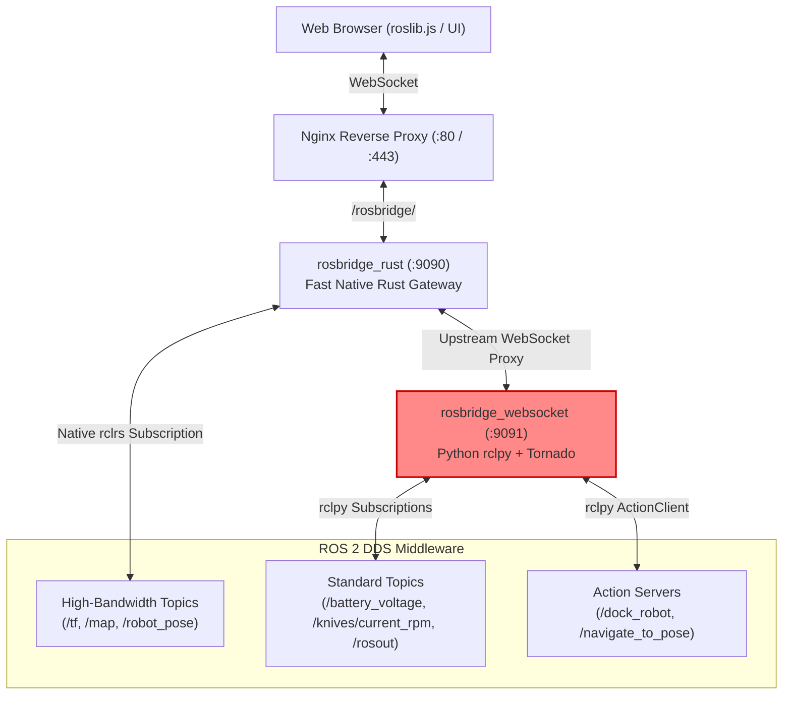

# Root Cause Investigation: Silent Loss of Telemetry and System Logs

> [!IMPORTANT]
> **Executive Summary**: The loss of battery status, blade RPM, system logs (`/rosout`), and navigation statuses on the ReloBot web interface is caused by a **silent failure of the ROS 2 executor thread (`Thread-1 (spin)`)** inside the upstream Python `rosbridge_websocket` service (port `9091`). 
>
> While Tornado continues running on the main thread and accepts incoming WebSocket connections, its ROS 2 executor is completely dead. As a result, no incoming ROS 2 messages are dispatched to the WebSocket clients. Because the process never exits, Docker does not restart it, leaving the bridge in a zombie state until the stack is rebooted.

---

## 1. Observed Symptoms & Problem Statement

* **Telemetry Vanishes**: After running the robot for a variable duration, telemetry metrics (battery voltage, charger voltage, blade RPM) and streaming logs (`/rosout`) stop updating and disappear from the web dashboard.
* **Persistent across Page Refresh**: Refreshing the browser page does **not** restore telemetry. The client connects and sends subscription requests, but receives no incoming data frames.
* **Resolved only by Stack Restart**: Restarting the robot stack (`./start_robot.sh down && ./start_robot.sh up`) temporarily restores functionality until the failure triggers again.
* **Selective Outage**: Map streaming and high-bandwidth TF updates remain functional because they bypass the Python bridge through native channels in [rosbridge_rust](file:///home/admin/projects/relobot/ros2_ws/src/rosbridge_rust/src/client.rs).

---

## 2. Architecture & Data Flow

ReloBot employs a hybrid, multi-tier WebSocket gateway architecture designed to optimize CPU usage and socket bandwidth on the Raspberry Pi 5.



### Component Breakdown
1. **Nginx Frontend ([relobot_locations.conf](file:///home/admin/projects/relobot/ros2_ws/src/web_server/frontend/snippets/relobot_locations.conf))**:
   Proxies WebSocket connection requests on `/rosbridge/` to local port `9090`.
2. **Rust Gateway ([rosbridge_rust](file:///home/admin/projects/relobot/ros2_ws/src/rosbridge_rust/src/main.rs))**:
   * Intercepts `/tf`, `/map`, `/robot_pose`, and binary map streams (`/map-ws/`) to deliver zero-copy, rate-limited streaming.
   * For all other topic subscriptions, service calls, and actions, routes frames upstream to `ws://127.0.0.1:9091` via [upstream.rs](file:///home/admin/projects/relobot/ros2_ws/src/rosbridge_rust/src/upstream.rs).
3. **Python Bridge ([rosbridge_webvideo_launch.py](file:///home/admin/projects/relobot/ros2_ws/src/rosbridge_webvideo_launch.py))**:
   * Uses standard ROS 2 `rosbridge_suite` (`rosbridge_websocket`).
   * Hosts a Tornado I/O loop in the main thread (`Thread-0`).
   * Spawns a background thread (`Thread-1 (spin)`) running `rclpy.spin()`.

---

## 3. Empirical Evidence & Forensic Findings

### 3.1 Hardware Nodes & ROS 2 Topics are Healthy
During active outage, ROS 2 topics were verified directly via command-line tools inside the running containers:

```bash
# Verification 1: Topic publication frequency
$ ros2 topic hz /battery_voltage
average rate: 10.048 Hz (window: 12)
average rate: 9.991 Hz  (window: 33)

# Verification 2: Active data values
$ ros2 topic echo /battery_voltage --once
data: 25.094999313354492

$ ros2 topic echo /knives/current_rpm --once
data: 0.0
```

Both `ina226_node` and `knives_node` micro-ROS agents were functioning normally and actively publishing messages over FastDDS.

---

### 3.2 The Primary Failure: `Thread-1 (spin)` Crash
Inspection of `ros2_rosbridge` container logs revealed an uncaught fatal exception originating in `rclpy`'s wait-set polling loop at timestamp `1791809796`:

```text
[rosbridge_websocket-1] Exception in thread Thread-1 (spin):
[rosbridge_websocket-1] Traceback (most recent call last):
[rosbridge_websocket-1]   File "/usr/lib/python3.10/threading.py", line 1016, in _bootstrap_inner
[rosbridge_websocket-1]     self.run()
[rosbridge_websocket-1]   File "/usr/lib/python3.10/threading.py", line 953, in run
[rosbridge_websocket-1]     self._target(*self._args, **self._kwargs)
[rosbridge_websocket-1]   File "/opt/ros/humble/local/lib/python3.10/dist-packages/rclpy/executors.py", line 298, in spin
[rosbridge_websocket-1]     self.spin_once()
[rosbridge_websocket-1]   File "/opt/ros/humble/local/lib/python3.10/dist-packages/rclpy/executors.py", line 773, in spin_once
[rosbridge_websocket-1]     self._spin_once_impl(timeout_sec)
[rosbridge_websocket-1]   File "/opt/ros/humble/local/lib/python3.10/dist-packages/rclpy/executors.py", line 762, in _spin_once_impl
[rosbridge_websocket-1]     handler, entity, node = self.wait_for_ready_callbacks(timeout_sec=timeout_sec)
[rosbridge_websocket-1]   File "/opt/ros/humble/local/lib/python3.10/dist-packages/rclpy/executors.py", line 745, in wait_for_ready_callbacks
[rosbridge_websocket-1]     return next(self._cb_iter)
[rosbridge_websocket-1]   File "/opt/ros/humble/local/lib/python3.10/dist-packages/rclpy/executors.py", line 639, in _wait_for_ready_callbacks
[rosbridge_websocket-1]     waitable.add_to_wait_set(wait_set)
[rosbridge_websocket-1]   File "/opt/ros/humble/local/lib/python3.10/dist-packages/rclpy/action/client.py", line 370, in add_to_wait_set
[rosbridge_websocket-1]     self._client_handle.add_to_waitset(wait_set)
[rosbridge_websocket-1] rclpy._rclpy_pybind11.RCLError: Failed to add 'rcl_action_client_t' to wait set: action client pointer is invalid, at ./src/rcl_action/action_client.c:470
```

---

### 3.3 The Zombie State (Why Tornado Survives but ROS 2 Dies)
* **Tornado Loop Remains Healthy**: Because Python executes the WebSocket network server in the main thread and runs `rclpy.spin()` in a background worker thread (`Thread-1`), an unhandled exception in `Thread-1` does **not** crash the Python interpreter.
* **Misleading Logs**: When a user reloads the browser, Tornado logs successful client connection and subscription:
  ```text
  [rosbridge_websocket]: Client connected. 1 clients total.
  [rosbridge_websocket]: [Client ...] Subscribed to /battery_voltage
  [rosbridge_websocket]: [Client ...] Subscribed to /knives/current_rpm
  ```
* **No Callbacks Fired**: Because `Thread-1` is dead, `rclpy.executors.spin_once()` is never invoked again. DDS message queues sit unprocessed in memory, and no telemetry JSON frames are constructed or transmitted over WebSocket.

---

### 3.4 Subscription Accumulation & Churn
Inspecting topic subscription endpoints via `ros2 topic info -v` revealed leaked, redundant subscriptions on `rosbridge_websocket`:

```text
Topic: /battery_voltage
Subscription count: 4
  - Node: rosbridge_websocket (GID ...25.04)
  - Node: rosbridge_websocket (GID ...6d.04)
  - Node: rosbridge_websocket (GID ...7b.04)
  - Node: rosbridge_websocket (GID ...88.04)
```

Each browser tab refresh or reconnect cycle accumulated unclosed subscriber handles within Python's node context, increasing wait-set memory overhead.

---

## 4. Deep-Dive: Root Cause Analysis

### Upstream Bug Mechanism (RobotWebTools/rosbridge_suite #1144 / #1159)
1. **Dynamic Action Creation & Destruction**:
   In `rosbridge_library/capabilities/send_action_goal.py` and `internal/actions.py`:
   ```python
   # Inside SendGoal.send_goal():
   client = ActionClient(node_handle, action_class, action_name)
   # ... wait for action goal completion / timeout ...
   client.destroy()
   ```
2. **Race Condition in `rclpy` Wait Sets**:
   When an action (such as `/dock_robot`) is dispatched or cancelled, `client.destroy()` invalidates the internal C structure `rcl_action_client_t`.
   If the executor is simultaneously executing its iteration in `wait_for_ready_callbacks` across threads, `client._client_handle.add_to_waitset(wait_set)` is invoked on an already freed or deallocated C pointer.
3. **No Exception Boundary in `rclpy.spin()`**:
   In `rclpy/executors.py`, `spin()` runs:
   ```python
   def spin(self):
       while self._is_spinning:
           self.spin_once()
   ```
   There is no `try...except RCLError` block guarding `spin_once()`. Any wait-set validation failure raises directly into `threading.py`'s `run()` method, terminating `Thread-1`.

---

## 5. Validated vs. Invalidated Hypotheses

| Hypothesis | Verdict | Evidence / Rationale |
| :--- | :---: | :--- |
| **Microcontroller / micro-ROS Failure** | ❌ **Invalidated** | `ros2 topic hz /battery_voltage` verified steady 10 Hz publication with real voltage data. |
| **Nginx Proxy Timeout / Breakdown** | ❌ **Invalidated** | Nginx access and error logs show 100% successful proxying and HTTP 101 WebSocket upgrades. |
| **Frontend JavaScript Crash** | ❌ **Invalidated** | Browser successfully establishes WebSocket handshakes and dispatches subscription frames upon refresh. |
| **Rust Gateway (`rosbridge_rust`) Failure** | ❌ **Invalidated** | `rosbridge_rust` remains responsive on `:9090`; binary map and TF transforms continue streaming. |
| **Python ROS 2 Spin Thread Crash** | ✅ **Confirmed** | Exact traceback located in `ros2_rosbridge` container logs with `RCLError` in `Thread-1 (spin)`. |

---

## 6. Comprehensive Remediation Plan

### Phase 1: Immediate Fault Tolerance (Fail-Fast & Process Watchdog)
Currently, a failure in `Thread-1` results in a silent zombie state. We must ensure the process either recovers or restarts immediately:

1. **Fatal Thread Watchdog**:
   Add a thread health check in the main process loop of `rosbridge_server`. If `Thread-1 (spin)` is no longer `.is_alive()`, log a critical error and call `os._exit(1)`. This triggers Docker Compose's `restart: unless-stopped` to reboot the container in $<1$ second.
2. **Resilient Executor Spin Loop**:
   Wrap `spin_once()` inside a try-catch loop to intercept `RCLError`:
   ```python
   while rclpy.ok():
       try:
           executor.spin_once(timeout_sec=0.1)
       except RCLError as e:
           logger.warning(f"Recovered from transient wait-set error: {e}")
           time.sleep(0.05)
   ```

### Phase 2: Action Client Lifecycle Optimization
1. **Persistent Action Client Pool**:
   Modify `rosbridge_library/internal/actions.py` to cache and reuse `ActionClient` instances instead of repeatedly creating and destroying them per goal.
2. **Dedicated Action Gateway or Service Fallbacks**:
   Route high-level mission actions (Docking, Exploration, Navigation) through dedicated ROS 2 services or direct action servers, bypassing dynamic creation in `rosbridge_library`.

### Phase 3: Rust Gateway Upstream Connection Cleanup
1. **Subscription Deduplication in `rosbridge_rust`**:
   In [upstream.rs](file:///home/admin/projects/relobot/ros2_ws/src/rosbridge_rust/src/upstream.rs), ensure previous subscription keys are explicitly unsubscribed or unadvertised when clients cycle, eliminating duplicate GIDs on the Python node.
2. **Extend Native Subscriptions in `rosbridge_rust`**:
   Progressively migrate critical telemetry topics (`/battery_voltage`, `/knives/current_rpm`, `/diagnostics`) to native Rust subscriptions, mirroring the high-reliability implementation already in place for `/tf` and `/map`.
